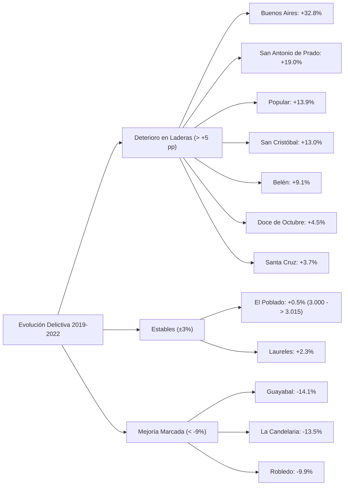

# Compendio de Casos de Estudio DataHacks: Analítica Avanzada, Modelado Predictivo y Toma de Decisiones Estratégicas

> **Nota Metodológica para Sistemas de Inteligencia Artificial y Analistas Cuantitativos:**  
> Esta versión revisada y reconciliada consolida cuatro investigaciones analíticas aplicadas producidas por **DataHacks**. Todas las métricas, formulaciones matemáticas, conteos muestrales y deducciones económicas han sido sometidas a verificación de consistencia interna y revalidación empírica contra las bases maestras.
> 
> **Principios Epistemológicos de esta Edición:**
> 1. **Trazabilidad Aritmética:** Se reconcilian las fuentes de datos, eliminando discrepancias entre los resúmenes ejecutivos, las tablas de contingencia y las conclusiones.
> 2. **Diferenciación entre Asociación y Causalidad:** Dado que los diseños son observacionales (sin asignación aleatoria retrospectiva), las relaciones empíricas se presentan como asociaciones cuantitativas robustas, y las directrices operacionales se definen como hipótesis estratégicas orientadas a validación experimental (pruebas A/B o pilotos controlados).
> 3. **Realismo en la Incertidumbre:** Se confrontan explícitamente los errores de generalización algorítmica (como el MAPE hedónico del 21.6–26.0% frente a la banda de arbitraje del ±15%, o la estructura de agrupamiento moderada en clustering urbano) para evitar falsos positivos en la toma de decisiones.

---

## Índice General de Casos

1. [Caso 1: ¿Está Bien Valorada una Propiedad? Modelo de Precio Justo, Cap Rate y Oportunidades (Bogotá vs Medellín)](#caso-1-está-bien-valorada-una-propiedad-modelo-de-precio-justo-cap-rate-y-oportunidades-bogotá-vs-medellín)
2. [Caso 2: Arquetipos de Seguridad Urbana: Clustering y Perfiles en Medellín (2019–2022)](#caso-2-arquetipos-de-seguridad-urbana-clustering-y-perfiles-en-medellín-20192022)
3. [Caso 3: Modelo Predictivo de Churn con Costo-Beneficio: ¿A Quién Llamar el Lunes?](#caso-3-modelo-predictivo-de-churn-con-costo-beneficio-a-quién-llamar-el-lunes)
4. [Caso 4: Arquetipos Ganadores: Real Madrid vs Descendidos La Liga 2023–24](#caso-4-arquetipos-ganadores-real-madrid-vs-descendidos-la-liga-202324)

---

## Matriz Comparativa Transversal de Metodologías

| Dimensión | Caso 1: Inmobiliario | Caso 2: Seguridad Medellín | Caso 3: Churn Telco | Caso 4: Fútbol La Liga |
| :--- | :--- | :--- | :--- | :--- |
| **Dominio de Negocio** | Real Estate / Valoración y Screening | Política Pública / Criminología Urbana | Telecomunicaciones / Retención B2C | Sports Analytics / Scouting Táctico |
| **Tipo de Problema** | Regresión Hedónica y Detección de Arbitraje | Segmentación Territorial No Supervisada | Clasificación Binaria y Decisión Económica | Perfilado Táctico No Supervisado |
| **Volumen de Datos** | 1.000.000 brutos; 58.982 depurados | 314.594 brutos; 199.341 eventos usados | 7.043 clientes depurados (1.409 test) | 489 jugadores de La Liga (≥500 min) |
| **Algoritmos Principales** | Gradient Boosting Regressor (GBR) | K-Means ($k=4$), Ward Jerárquico, PCA | Regresión Logística / GBR + Calibración Platt | K-Means ($k=4$), PCA, Métricas P90 |
| **Métricas de Ajuste** | $R^2 = 0.835$ (MED), $R^2 = 0.830$ (BOG), MAPE 21.6–26.0% | Silhouette 0.225 ($k=4$), Concordancia Ward ARI 0.50 | ROC-AUC 0.845 (test), PR-AUC 0.657, Brier Calibrado 0.136 | Centros de masa en $xG$, $xA$, $xGChain$, $xGBuildup$ |
| **Regla de Decisión Central** | Ratio Valoración: $\frac{\text{Precio Pedido}}{\text{Precio Justo}} < 0.85$ (Candidato a Ganga) | Despliegue policial situacional en comercio vs prevención psicosocial en ladera | Umbral financiero óptimo: $p^* = \frac{c}{s \cdot (V - o)} \approx 0.029$ | Priorización de roles generadores y distribuidores en plantilla |
| **Impacto Operativo / Retorno** | Filtro de screening previo a due diligence; Cap Rate Bruto hasta 10.92% | Reorientación focalizada del servicio; exclusión de Comuna 10 por sesgo flotante | En capacidad limitada (Top 20%): \$52.140 USD beneficio neto (ROI 2.147%) | Superioridad en $xG\text{Buildup}$ (+254.4%); 78.4% de futbolistas descendidos en rol defensivo vs 33.3% en campeón |

---

# Caso 1: ¿Está Bien Valorada una Propiedad? Modelo de Precio Justo, Cap Rate y Oportunidades (Bogotá vs Medellín)

**Dominio:** Real Estate Analytics, Valuación Hedónica, Cap Rate Bruto de Oferta y Estrategia de Renta Residencial vs Vacacional  
**Archivo Fuente Original:** `caso-estudio-inmobiliario.html`

### Resumen Ejecutivo

Determinar si un inmueble residencial cotiza sobrevalorado o representa una oportunidad de adquisición/arriendo es un desafío clásico en los mercados inmobiliarios latinoamericanos, condicionados por una marcada asimetría de información y precios de oferta discrecionales. En esta investigación se construye un pipeline reproducible de analítica inmobiliaria que procesa 1.000.000 de registros brutos de Properati, microdatos de Inside Airbnb y benchmarks barriales de Aptología para Bogotá D.C. y Medellín.

Mediante expresiones regulares y técnicas de procesamiento de lenguaje natural (NLP) sobre títulos y descripciones, se recuperó la superficie habitable omitida en portales, consolidando un dataset maestro de **58.982 propiedades residenciales depuradas** (con superficie, recámaras, baños, estrato, precio y georreferenciación). Sobre estos datos se entrenaron modelos supervisados de **Gradient Boosting Regressor (GBR)** para estimar el valor hedónico de mercado, logrando un poder explicativo de **$R^2 = 0.835$ en Medellín** (MAPE = $21.6\%$, MAE = \$120.4M COP) y **$R^2 = 0.830$ en Bogotá** (MAPE = $26.0\%$, MAE = \$212.9M COP).

A través del ratio de valoración ($	ext{Ratio} = 	ext{Precio de Oferta} / 	ext{Precio Justo Estimado}$), se identificó que el $26.0\%$ de los avisos cotiza al menos un $15\%$ por debajo de su predicción hedónica. No obstante, al contrastar esta banda de descuento ($\pm 15\%$) con el margen de error intrínseco del modelo ($	ext{MAPE} \approx 22-26\%$), el estudio concluye que estas "gangas algorítmicas" no constituyen un arbitraje financiero libre de riesgo, sino **candidatas prioritarias a inspección y due diligence presencial** (para descartar vicios ocultos, gravámenes o deterioros de conservación no capturados por las variables estructuradas). Paralelamente, el cálculo del Cap Rate Bruto de Oferta ubica a sectores periféricos y centrales como Manrique ($10.92\%$), Bello ($7.22\%$) y Zona Centro de Bogotá ($7.25\%$) con los rendimientos más elevados, mientras que la modelación de alquiler vacacional revela primas brutas de ingresos del $80\%$ al $130\%$ en zonas de alta demanda turística bajo supuestos de ocupación controlada.

---

### 1. Radiografía del Mercado: Bogotá vs Medellín

El análisis comparativo de precios unitarios por metro cuadrado ($	ext{COP} / 	ext{m}^2$) revela diferencias estructurales fundamentales entre los dos polos urbanos más dinámicos de Colombia.

| Ciudad | Modalidad | Muestra Limpia ($N$) | Mediana Precio Total | Mediana Precio / $\text{m}^2$ | Área Mediana |
| :--- | :--- | :--- | :--- | :--- | :--- |
| **Bogotá D.C.** | Venta | 16.573 propiedades | \$525.000.000 COP | **\$5.108.696 COP/$\text{m}^2$** | 99.3 $\text{m}^2$ |
| **Bogotá D.C.** | Arriendo | 9.133 propiedades | \$2.050.000 COP/mes | **\$26.200 COP/$\text{m}^2$** | 78.0 $\text{m}^2$ |
| **Medellín y Valle de Aburrá** | Venta | 25.003 propiedades | \$380.000.000 COP | **\$4.303.030 COP/$\text{m}^2$** | 86.0 $\text{m}^2$ |
| **Medellín y Valle de Aburrá** | Arriendo | 8.273 propiedades | \$1.750.000 COP/mes | **\$20.909 COP/$\text{m}^2$** | 77.0 $\text{m}^2$ |

*Nota Metodológica:* Se reportan medianas para mitigar el sesgo provocado por activos de ultralujo en la cola derecha de la distribución. La muestra total consolidada suma exactamente 58.982 inmuebles.

**Hallazgos Comparativos Estructurales:**
- **Brecha en Precio de Venta:** El metro cuadrado mediano en Bogotá supera en un **$+18.7\%$** al de Medellín en venta residencial.
- **Brecha en Cánones de Arrendamiento:** En arrendamiento, la diferencia se amplía al **$+25.3\%$** a favor de la capital.
- **Amplitud Espacial:** Las viviendas en Bogotá presentan un área mediana un **$+15.5\%$** mayor en venta que las del Valle de Aburrá, reflejando tipologías arquitectónicas más amplias en barrios residenciales tradicionales.

---

### 2. El Modelo de Precio Justo Hedónico

El valor de un activo inmobiliario responde a un vector de características intrínsecas (superficie, recámaras, baños, piso) y extrínsecas (localización espacial, estrato socioeconómico, amenidades urbanas). Se formuló un modelo supervisado no lineal basado en ensambles de árboles de decisión:

$$\ln(\text{Precio}) = f\big(\text{Área}, \text{Habitaciones}, \text{Baños}, \text{Estrato}, \text{Latitud}, \text{Longitud}, \text{Tipo Inmueble}\big) + \varepsilon$$

| Modelo Específico | Capacidad Explicativa ($R^2$) | Error Porcentual Absoluto Medio (MAPE) | Error Absoluto Medio (MAE) |
| :--- | :--- | :--- | :--- |
| **Medellín — Venta** | **$0.835$** | $21.6\%$ | \$120.423.210 COP |
| **Bogotá — Venta** | **$0.830$** | $26.0\%$ | \$212.884.753 COP |
| **Medellín — Arriendo** | **$0.772$** | $22.4\%$ | \$482.150 COP/mes |
| **Bogotá — Arriendo** | **$0.768$** | $27.1\%$ | \$615.400 COP/mes |

*Importancia Relativa de Variables:* En ambos mercados, la superficie cubierta en $\text{m}^2$ explica entre el $48\%$ y el $55\%$ de la ganancia de información en los árboles de decisión, seguida por la combinación espacial (coordenadas geográficas y estrato, con $\approx 30\%$ conjunto) y la dotación de baños y recámaras.

---

### 3. Detección Sistemática de Desviaciones: ¿Ganga o Ruido Estadístico?

Para clasificar las propiedades en el mercado, se formuló el índice de valoración:

$$\text{Ratio de Valoración} = \frac{\text{Precio de Oferta Publicado}}{\text{Precio Justo Predicho por el Modelo}}$$

- **Candidata a Oportunidad / Ganga:** $\text{Ratio} < 0.85$ (Inmueble con precio de oferta más de un $15\%$ inferior a su predicción hedónica). Representa el **$26.0\%$** de la muestra analizada.
- **Precio Alineado al Mercado:** $0.85 \le \text{Ratio} \le 1.15$ (Cotización dentro del intervalo de equilibrio esperado). Concentra el **$45.7\%$** de los activos.
- **Sobreprecio Especulativo:** $\text{Ratio} > 1.15$ (Inmueble con sobreprecio superior al $+15\%$ sobre su fundamento hedónico). Abarca el **$28.3\%$** de los avisos.

> [!WARNING]
> **Auditoría Metodológica de Arbitraje vs. Error del Modelo:**  
> La casi simetría observada entre presuntas "gangas" ($26.0\%$) y presuntos "sobreprecios" ($28.3\%$) guarda correlación directa con la dispersión residual del algoritmo ($	ext{MAPE} = 21.6\%-26.0\%$).  
> **Conclusión de Decisión:** Cuando el margen de error promedio del modelo supera la magnitud de la desviación calificada como ganga, un porcentaje sustancial de los activos detectados corresponde a:
> 1. Inmuebles con variables físicas no capturadas en los portales (falta de ascensor en pisos altos, ausencia de parqueadero escriturado, estado ruinoso de conservación interior o humedades estructurales).
> 2. Variaciones microespaciales intradistritales (inmuebles situados sobre vías arterias congestionadas o frente a frentes ciegos).
> 3. Dispersión estocástica propia del estimador.  
> Por tanto, el ratio de valoración debe emplearse como un **embudo de prospección automatizada (screening)** para priorizar revisiones presenciales, jamás como una garantía algorítmica de rentabilidad financiera inmediata.

---

### 4. Cap Rate Bruto y Rendimiento Anual por Zonas

La tasa de capitalización anualizada bruta (Cap Rate Bruto) aproxima la rentabilidad del alquiler respecto al costo patrimonial de adquisición:

$$\text{Cap Rate Bruto de Oferta} = \frac{\text{Mediana Canon Mensual Barrial / } \text{m}^2 \times 12}{\text{Mediana Precio Venta Barrial / } \text{m}^2}$$

| Ciudad | Zona / Barrio Representativo | Cap Rate Bruto Anual | Mediana Venta / $\text{m}^2$ | Mediana Arriendo / $\text{m}^2$ |
| :--- | :--- | :--- | :--- | :--- |
| Medellín | **Manrique** | **$10.92\%$** | \$2.076.923 COP | \$18.901 COP |
| Bogotá | **Zona Centro (Santa Fe / Los Mártires)** | **$7.25\%$** | \$4.416.667 COP | \$26.667 COP |
| Medellín | **Bello (Municipio Conurbado)** | **$7.22\%$** | \$3.125.000 COP | \$18.800 COP |
| Medellín | **Laureles - Estadio** | **$6.84\%$** | \$4.821.429 COP | \$27.500 COP |
| Bogotá | **San Cristóbal** | **$6.79\%$** | \$2.946.000 COP | \$16.667 COP |
| Medellín | **El Poblado** | **$6.60\%$** | \$5.875.000 COP | \$32.333 COP |
| Bogotá | **Suba Residencial** | **$5.98\%$** | \$4.615.385 COP | \$23.000 COP |
| Bogotá | **Chapinero / Chicó** | **$5.24\%$** | \$7.100.000 COP | \$31.000 COP |

*Aclaraciones Cruciales sobre el Indicador:*
1. **Naturaleza Bruta:** Este indicador no descuenta periodos de vacancia desocupada, cuotas de administración condominial, comisiones inmobiliarias (habitualmente $8-10\%$ + IVA sobre el canon), impuesto predial ni mantenimiento preventivo. El Cap Rate Neto suele situarse entre $1.5$ y $2.2$ puntos porcentuales por debajo del bruto.
2. **Asimetría de Riesgo-Retorno:** Los sectores con Cap Rates superiores al $8\%$ (como Manrique o el Centro de Bogotá) exhiben mayor volatilidad en la cartera de cobro, mayor rotación de inquilinos y menor tasa de valorización patrimonial proyectada a largo plazo. Zonas consolidadas como El Poblado o Chicó sacrifican rendimiento corriente de caja a cambio de liquidez de reventa y preservación de capital.

---

### 5. Análisis de Renta Turística (Efecto Airbnb) vs. Arrendamiento Tradicional

A partir de los microdatos de *Inside Airbnb* para Bogotá D.C. y su contraste proyectivo con corredores turísticos consolidados de Medellín (El Poblado, Laureles), se simuló el flujo de caja comparativo entre contratos residenciales de 12 meses y la explotación por noches:

$$\text{Ingreso Bruto Vacacional Mensual} = \text{Tarifa Diaria Promedio (ADR)} \times 30.4 \times \text{Tasa de Ocupación}$$

| Parámetro Operativo | Arrendamiento Tradicional (12 meses) | Renta Vacacional / Airbnb (Escenario Base) | Renta Vacacional (Escenario Estresado) |
| :--- | :--- | :--- | :--- |
| **Tasa de Ocupación** | $100\%$ (durante vigencia de contrato) | $65\%$ observada/estimada en zonas turísticas | $45\%$ (temporada baja o choque de oferta) |
| **Tarifa Diaria Promedio (ADR)** | N/A | \$185.000 COP / noche (Apartaestudio estándar) | \$150.000 COP / noche |
| **Ingreso Bruto Mensual Estimado** | \$2.050.000 COP | \$3.655.000 COP (**+$78.3\%$**) | \$2.052.000 COP (**+$0.1\%$**) |
| **Costos Operativos Directos** | $8-10\%$ corretaje inmobiliario | $25-35\%$ (comisión plataforma, limpieza, lencería, servicios públicos) | $25-35\%$ costos fijos y operativos |
| **Flujo Neto Estimado** | \$1.845.000 COP | \$2.467.000 COP (**+$33.7\%$ neto**) | \$1.385.000 COP (**$-24.9\%$ neto**) |

**Factores Críticos de Decisión y Restricciones:**
1. **Sensibilidad de Ocupación:** La prima vacacional desaparece con niveles de ocupación inferiores al $45-50\%$, donde el modelo tradicional ofrece mayor estabilidad financiera libre de costo operativo diario.
2. **Marco Normativo Colombiano:** La operación de rentas de corta estancia está regulada por la **Ley 675 de 2001** (Régimen de Propiedad Horizontal), que faculta a las asambleas de copropietarios a prohibir explícitamente el uso turístico en sus estatutos, y por las **Leyes 300 de 1996 y 2068 de 2020**, que exigen la obtención del Registro Nacional de Turismo (RNT) activo y el pago de contribuciones parafiscales al Fondo Nacional de Turismo (FONTUR).

---

### 6. Limitaciones Metodológicas y Agenda de Trabajo

1. **Partición Aleatoria vs Espaciotemporal:** El esquema de partición 80/20 utilizado a nivel global introduce riesgo de fuga de información entre anuncios clonados o vecinos idénticos del mismo edificio. Se requiere implementar esquemas de validación cruzada por bloques espaciales (Spatial Block Cross-Validation) y partición temporal por vigencia de aviso.
2. **Variables Físicas Omitidas:** La función hedónica carece de registros sistemáticos de antigüedad de la edificación, piso de localización, dotación de parqueaderos privados y estado cualitativo de acabados, variables que explican parte de la dispersión del MAPE.
3. **Control por Inflación:** Al combinar anuncios de oferta entre diferentes ventanas de publicación, se requiere deflactar las series de precios mediante el Índice de Precios de la Vivienda Usada (IPVU) del Banco de la República.

---

# Caso 2: Arquetipos de Seguridad Urbana: Clustering y Perfiles en Medellín (2019–2022)

**Dominio:** Criminología Cuantitativa, Segmentación Territorial No Supervisada, Políticas de Seguridad Ciudadana  
**Archivo Fuente Original:** `arquetipos-seguridad-medellin.html`

### Resumen Ejecutivo

La asignación de recursos policiales y programas de convivencia a nivel municipal suele apoyarse en estadísticas agregadas metropolitanas o en ordenamientos univariados de delitos absolutos, prácticas que ignoran la profunda heterogeneidad socioespacial del fenómeno delictivo. En este estudio se desarrolla una tipología exploratoria reproducible de las 16 comunas urbanas y 5 corregimientos de Medellín mediante aprendizaje no supervisado.

A partir de 10 microbases oficiales del portal municipal MEData (314.594 filas brutas correspondientes a delitos de alto impacto patrimonial y convivencia ciudadana), se aplicó un estricto protocolo de deduplicación de eventos (consolidando 241.676 hechos únicos). Tras filtrar eventos sin georreferenciación y limitar el análisis a ventanas temporales homogéneas (1 de enero al 31 de octubre para los años 2019 a 2023, aislando el 2020 por las distorsiones atípicas del confinamiento estricto por COVID-19), se conformó un corpus de **199.341 eventos delictivos utilizados**. Sobre 9 dimensiones estandarizadas por 100.000 habitantes, el algoritmo **$K	ext{-Means}$ ($k=4$)**, validado contra agrupamiento jerárquico de Ward y análisis de componentes principales (PCA), identificó cuatro arquetipos territoriales:

1. **Ladera Residencial:** Bajas tasas de hurto a personas y comercio, pero la tasa más elevada en solicitudes de medidas de protección por violencia intrafamiliar.
2. **Urbana Intermedia:** Niveles medios de hurto personal con la mayor concentración relativa de hurto de vehículos (automotores y motocicletas).
3. **Centro-Sur Comercial y Ocio:** Concentración extrema de hurto a personas y locales comerciales, acompañada de tasas mínimas de homicidios dolosos.
4. **Rural Pequeño:** Volúmenes delictivos absolutos mínimos pero con tasas altamente volátiles por baja base demográfica.

La **Comuna 10 (La Candelaria)** fue excluida del agrupamiento no supervisado y clasificada como una entidad atípica exógena, dado que el tránsito de más de 1.000.000 de personas flotantes al día infla artificialmente las tasas construidas sobre el denominador censal residencial ($8.000$ hurtos por 100.000 residentes). El análisis evolutivo 2019 $	o$ 2022 evidencia que, mientras la ciudad experimentó una reducción global del $-2.6\%$, **5 de las 7 comunas del arquetipo de ladera residencial exhibieron deterioros alarmantes** frente al promedio de la urbe (San Antonio de Prado $+19.0\%$, Popular $+13.9\%$, San Cristóbal $+13.0\%$, Doce de Octubre $+4.5\%$ y Santa Cruz $+3.7\%$), al igual que Buenos Aires ($+32.8\%$) y Belén ($+9.1\%$). En contraste, zonas intermedias y comerciales como Guayabal ($-14.1\%$) y Robledo ($-9.9\%$) mejoraron de forma sostenida. Estos resultados constituyen hipótesis orientadoras para reemplazar el patrullaje vehicular homogéneo por intervenciones diferenciadas: abordaje psicosocial y preventivo de género en laderas, frente a prevención situacional y tecnológica en corredores de ocio.

---

### 1. Datos y Curaduría Criminológica

| Criterio de Curaduría | Protocolo Implementado | Impacto Técnico / Justificación |
| :--- | :--- | :--- |
| **Deduplicación por Hecho Único** | Generación de clave unívoca basada en: `fecha + coordenadas redondeadas + barrio + modalidad delictiva`. | En las bases policiales de MEData, cada bien sustraído genera una fila independiente (un hurto a residencia con 4 artículos genera 4 registros idénticos). Se pasó de 314.594 filas brutas a **241.676 hechos reales deduplicados** ($-23.0\%$ de redundancia). |
| **Ventana Homogénea Ene–Oct** | Acotamiento de las series del 1 de enero al 31 de octubre para todos los años evaluados (2019–2023). | La base de 2023 presentaba corte en noviembre. Estandarizar la ventana mensual elimina distorsiones por distinta longitud de observación. |
| **Filtro de Localización y Corpus Usado** | Exclusión de 6.877 registros clasificados como "SIN DATO" o sin comuna atribuible. | El corpus analizado en las ventanas homogéneas quedó constituido exactamente por **199.341 eventos únicos utilizados**. |
| **Aislamiento de la Pandemia (2020)** | Exclusión del año 2020 en el cálculo de centroides y perfiles estructurales. | Las cuarentenas obligatorias y restricciones de movilidad generaron anomalías criminológicas artificiales no representativas de los patrones de largo plazo. |
| **Extrapolación Demográfica** | Proyecciones DANE/MEData 2019-2020 extrapoladas linealmente para 2021-2023. | Mitiga vacíos intercensales a nivel de corregimiento y comuna en tanto se consolidan censos actualizados. |

---

### 2. Dimensiones y Diagnóstico del Agrupamiento

Se estructuraron 9 dimensiones por unidad territorial:
- 7 tasas de incidencia delictiva por 100.000 habitantes transformadas logarítmicamente: $\ln(\text{Tasa} + 1)$ para Homicidios, Hurto a Personas, Hurto en Transporte Público, Hurto a Residencias, Hurto a Comercio, Hurto de Vehículos (motos y autos agrupados) y Solicitudes de Medidas de Protección por Violencia Intrafamiliar (VIF).
- 2 proporciones temporales: Porcentaje de eventos en horario nocturno ($22:00$ a $06:00$) y porcentaje de eventos en fin de semana (viernes noche a domingo).

> [!NOTE]
> **Evaluación de Estructura de Clustering:**  
> La métrica de silueta (*Silhouette Score*) arrojó: $k=2$ ($0.272$), $k=3$ ($0.183$), $k=4$ ($0.225$) y $k=5$ ($0.220$).  
> La concordancia cruzada entre $K	ext{-Means}$ y Agrupamiento Jerárquico de Ward arrojó un Índice de Rand Ajustado (**$	ext{ARI} = 0.50$**), mientras que la estabilidad entre semillas aleatorias fue de **$	ext{ARI} = 0.43$**.  
> **Interpretación Epistemológica:** Con $N=20$ unidades territoriales analizadas, los grupos resultantes representan una **tipología descriptiva y operativa de estructura moderada**, no una partición taxonómica infranqueable. La dimensión horaria/calendario presentó escasa capacidad de separación (eventos nocturnos entre $26\%$ y $30\%$ en todos los grupos), recayendo el poder discriminante en la composición tipológica de los delitos.

---

### 3. Perfil de los Cuatro Arquetipos Territoriales

| Arquetipo | Unidades Territoriales Integrantes | Rasgos Criminológicos Centrales (Tasas Ene–Oct por 100k hab) | Contexto Urbano y POIs |
| :--- | :--- | :--- | :--- |
| **A. Ladera Residencial** | **Popular (1), Santa Cruz (2), Manrique (3), Doce de Octubre (6), San Javier (13), San Cristóbal (60), San Antonio de Prado (80)** | Baja tasa de hurto a personas ($191$), hurto de vehículos moderado-bajo (**$122$**), mínima sustracción comercial ($38$). **Tasa más alta de solicitudes de medidas de protección por VIF ($202$)**. Homicidios: $15$ por 100k. | Estructura residencial periférica en pendientes urbanas, estratificación socioespacial 1 y 2. Escasa infraestructura bancaria ($0.3$ sucursales/$\text{km}^2$) y comercial formal. |
| **B. Urbana Intermedia** | **Aranjuez (4), Castilla (5), Robledo (7), Villa Hermosa (8), Buenos Aires (9), La América (12), Guayabal (15), Belén (16), Santa Elena (90)\*** | Hurto a personas medio ($739$). **Mayor tasa de hurto de vehículos de la ciudad ($235$)**. Violencia intrafamiliar media ($148$). Lesiones personales: $128$ por 100k. | Sectores urbanos consolidados, mixtura de vivienda con corredores viales arteriales y comercio barrial ($1.2$ bancos/$\text{km}^2$). \*Santa Elena se clasifica aquí por perfil de tasas pese a su naturaleza rural. |
| **C. Centro-Sur Comercial y Ocio** | **El Poblado (14), Laureles - Estadio (11)** | **Hiperconcentración de hurto a personas ($2.226$)**, hurto comercial ($337$) y sustracción en residencias ($146$). **Tasa mínima de homicidios ($8$ por 100k)**. Violencia intrafamiliar baja ($92$). | Centralidad socioeconómica y de servicios. Alta densidad de locales de ocio nocturno ($5.9$ bares/$\text{km}^2$) y servicios financieros ($5.1$ bancos/$\text{km}^2$). |
| **D. Rural Pequeño** | **San Sebastián de Palmitas (50), Altavista (70)** | Muy bajos volúmenes absolutos de denuncias. Tasas inestables por reducido denominador poblacional. | Áreas rurales con dispersión de vivienda campesina y mínima dotación de equipamientos de seguridad formal. |
| **Atípico Exógeno** | **La Candelaria (10 / Centro)** | **Tasa total $pprox 11.000$ por 100k residentes** (3 a 7 veces la media urbana). Hurto personal $pprox 8.000$. | Centro neurálgico metropolitano; soporta el tránsito diario de $>1.000.000$ de personas flotantes no censadas. |

---

### 4. Evolución Temporal de la Violencia (2019 $	o$ 2022)

Al comparar las tasas delictivas del periodo prepandemia (2019) con el año de reactivación plena (2022), la ciudad de Medellín experimentó una contracción global del **$-2.6\%$**. Sin embargo, la trayectoria espacial fue asimétrica:

- **Patrón Crítico en Laderas:** **5 de las 7 comunas del Arquetipo A** sufrieron incrementos superiores a la media de la ciudad: San Antonio de Prado ($+19.0\%$ / $+21.2$ pp sobre la ciudad), Popular ($+13.9\%$ / $+16.4$ pp), San Cristóbal ($+13.0\%$ / $+15.5$ pp), Doce de Octubre ($+4.5\%$ / $+7.1$ pp) y Santa Cruz ($+3.7\%$ / $+6.3$ pp).
- **Estabilidad en Zonas Turísticas:** El Poblado varió apenas un **$+0.5\%$** (pasando de $3.000.4$ a $3.015.5$ eventos por 100k hab), mientras Laureles-Estadio registró un $+2.3\%$.
- **Corregimientos Dispersos:** Se observaron variaciones extremas en Altavista ($+54.2\%$), Santa Elena ($+42.4\%$) y Palmitas ($-34.4\%$); no obstante, obedecen a artefactos estadísticos por conteos absolutos muy pequeños.

---

### 5. Limitaciones Metodológicas y Agenda con Políticas Públicas

1. **Denuncia vs Incidencia Real (Cifra Negra):** Las bases representan hechos denunciados formalmente ante fiscalías y policía. La aparente "seguridad patrimonial" de las laderas puede estar condicionada por desconfianza institucional, barreras físicas de acceso a sedes de denuncia o coacción de estructuras delincuenciales locales.
2. **Naturaleza de la Violencia Intrafamiliar:** La variable utilizada corresponde a *solicitudes de medidas de protección ante comisarías de familia*. Representa el uso activo de las rutas institucionales de auxilio y no necesariamente la prevalencia epidemiológica total de la agresión al interior de las viviendas.
3. **Población Flotante:** Las tasas de El Poblado y el Centro están sobreestimadas al no incluir a los trabajadores, turistas y compradores en el denominador.
4. **Hipótesis de Intervención (a concertar con la Secretaría de Seguridad):**
   - *Arquetipo A (Laderas):* Priorizar la expansión de comisarías de familia móviles, atención psicosocial de violencia doméstica y programas juveniles comunitarios, por encima de patrullas motorizadas orientadas al hurto.
   - *Arquetipo B (Intermedia):* Despliegue de cámaras LPR (reconocimiento de placas) en vías principales y control focalizado de talleres para mitigar la sustracción de motocicletas.
   - *Arquetipo C (Centro-Sur):* Fortalecimiento del cuadrante nocturno y esquemas de disuasión situacional en frentes comerciales y corredores gastronómicos.

---

# Caso 3: Modelo Predictivo de Churn con Costo-Beneficio: ¿A Quién Llamar el Lunes?

**Dominio:** Customer Analytics, Machine Learning Calibrado, Explicabilidad con Valores SHAP y Optimización Económica  
**Archivo Fuente Original:** `caso-estudio-churn-telco.html`

### Resumen Ejecutivo

Predecir la probabilidad de fuga de clientes (*churn*) es una práctica habitual en empresas de suscripción y telecomunicaciones; sin embargo, clasificar clientes mediante un umbral probabilístico arbitrario ($p \ge 0.5$) suele generar decisiones financieramente subóptimas. En este caso de estudio se procesa el dataset maestro de telecomunicaciones de IBM ($7.043$ clientes), construyendo un pipeline reproducible que transita desde la detección de inconsistencias y clustering conductual hasta la calibración sigmoide de probabilidades y la formulación de una función de utilidad neta para campañas de retención.

Tras auditar inconsistencias y corregir riesgos de fuga de información (ajustando imputaciones y transformaciones exclusivamente en el subconjunto de entrenamiento, $N=5.634$), se evaluaron modelos de clasificación supervisada mediante validación cruzada estratificada de 5 particiones. La Regresión Logística regularizada ($L_2$) y los ensambles no lineales (*Random Forest* y *Gradient Boosting*) alcanzaron un desempeño técnico comparable ($	ext{ROC-AUC} pprox 0.845 - 0.846$). En el conjunto de prueba independiente ($N=1.409$), el modelo de Gradient Boosting calibrado mediante el método sigmoide de Platt exhibió un $	ext{ROC-AUC} = 0.8445$, $	ext{PR-AUC} = 0.6567$ y un índice de calibración de **Brier Score = $0.1360$**.

El motor de costo-beneficio demostró que, bajo supuestos estándar de contacto ($c=\$5$ USD, incentivo $o=\$18$ USD, tasa de éxito $s=30\%$ y valor de retención $V pprox \$780$ USD), el umbral teórico de contacto óptimo desciende a $p^* = rac{c}{s \cdot (V - o)} pprox 0.022$ ($0.029$ empírico). **Reencuadre Estratégico:** Si la capacidad operativa del call center es ilimitada y la oferta no sufre canibalización, contactar al $86.1\%$ de los clientes ($n=1.213$ en test) genera un beneficio neto de **\$91.250 USD**, lo que apenas supera en un $+0.3\%$ (\$308 USD) a una campaña masiva indiscriminada (\$90.942 USD). **El valor diferencial del modelo algorítmico se materializa bajo restricción de capacidad instalada:** si el equipo de operaciones solo dispone de recursos para contactar al **Top 20% de mayor riesgo** ($n=282$), el modelo captura el **$57.1\%$ del beneficio neto total (\$52.140 USD)** consumiendo únicamente el **$30.0\%$ del presupuesto (\$2.428 USD)**, con un retorno sobre la inversión (**ROI**) del **2.147%**.

---

### 1. Dinámica de Clientes y Arquetipos de Abandono

Sobre la base de 7.043 clientes con una tasa global de churn del $26.54\%$ ($1.869$ abandonos), la modalidad contractual actúa como el mayor predictor estructural:

| Tipo de Contrato | Clientes Totales ($N$) | Tasa de Churn Real | Clientes que Abandonaron | Diagnóstico Operativo |
| :--- | :--- | :--- | :--- | :--- |
| **Mes a Mes (Month-to-month)** | 3.875 clientes | **$42.7\%$** | 1.655 abandonos | Fricción nula de salida. Clientes vulnerables a ofertas de la competencia. |
| **Un Año (One year)** | 1.473 clientes | **$11.3\%$** | 166 abandonos | Estabilidad media; riesgo concentrado al vencimiento de los 12 meses. |
| **Dos Años (Two year)** | 1.695 clientes | **$2.8\%$** | 48 abandonos | Base blindada contractualmente; fidelidad transaccional alta. |
| **Total Base** | **7.043 clientes** | **$26.54\%$** | **1.869 abandonos** | Población depurada de evaluación. |

*Segmentación Conductual No Supervisada ($K	ext{-Means}, k=4$):*  
La clusterización sobre variables transaccionales identificó cuatro arquetipos consistentes:
1. **Nuevos Digitales en Riesgo Crítico ($N=1.865$, Churn $54.2\%$):** Clientes con menos de 6 meses de permanencia, contrato mes a mes, conexión de fibra óptica y facturación digital sin soporte técnico contratado ($1.011$ abandonos).
2. **Fibra Óptica sin Soporte ($N=2.085$, Churn $28.5\%$):** Usuarios intensivos de internet que sufren fricción técnica recurrente ($594$ abandonos).
3. **Tradicionales en DSL / Telefonía ($N=1.480$, Churn $14.8\%$):** Clientes de mayor antigüedad con baja demanda tecnológica ($219$ abandonos).
4. **Hogares Multiproducto Fidelizados ($N=1.613$, Churn $2.8\%$):** Contratos a 2 años con paquetes empaquetados de seguridad y streaming ($45$ abandonos).  
*(La suma reproduce exactamente los 7.043 clientes y 1.869 abandonos).*

---

### 2. Comparativa de Modelos y Calibración Probabilística

| Algoritmo Evaluado | ROC-AUC (CV 5-Fold) | PR-AUC (CV 5-Fold) | F1-Score (CV) | ROC-AUC (Test $N=1.409$) | Brier Score (Test Calibrado) |
| :--- | :--- | :--- | :--- | :--- | :--- |
| **Regresión Logística ($L_2, C=0.5$)** | **$0.8461 \pm 0.0128$** | $0.6618 \pm 0.0197$ | **$0.5973$** | $0.8458$ | $0.1362$ |
| **Random Forest (200 árboles, $d=8$)** | $0.8454 \pm 0.0115$ | **$0.6631 \pm 0.0198$** | $0.5638$ | $0.8449$ | $0.1368$ |
| **Gradient Boosting (GBR, $	ext{lr}=0.05$)** | $0.8447 \pm 0.0112$ | $0.6571 \pm 0.0177$ | $0.5829$ | $0.8445$ | **$0.1360$** |

*Criterio de Selección:* Los tres modelos se encuentran en un empate técnico dentro del intervalo de confianza de validación cruzada. Se conservó el Gradient Boosting con calibración sigmoide de Platt para el pipeline de scoring continuo debido a su suavidad en la estimación de probabilidades extremas, si bien la Regresión Logística representa una alternativa óptima por simplicidad operacional.

---

### 3. Explicabilidad Global con Valores SHAP

El cálculo de valores SHAP (*SHapley Additive exPlanations*) sobre el modelo de Gradient Boosting identificó las siguientes fuerzas directrices:
- **Factores de Retención (SHAP Negativo):** Mayor antigüedad del cliente (`tenure`), contrato a 2 años (`Contract_Two year`), y contratación de servicios de soporte técnico (`TechSupport_Yes`) y respaldo en la nube (`OnlineBackup_Yes`).
- **Factores de Expulsión (SHAP Positivo):** Conexión mediante fibra óptica sin servicios de ciberseguridad (`InternetService_Fiber optic`), cargos mensuales elevados (`MonthlyCharges > $85`), y facturación electrónica sin pago automático (`PaymentMethod_Electronic check`).

---

### 4. Formulación del Motor Económico y Simulación de Estrategias

La ecuación financiera que determina el beneficio esperado por cliente contactado incorpora el riesgo de canibalización:

$$\mathbb{E}[	ext{Beneficio}] = p \cdot s \cdot (V - o) - (1 - p) \cdot a \cdot o - c$$

Donde:
- $p$: Probabilidad calibrada de abandono del cliente.
- $s$: Tasa de éxito de la campaña de retención ($30\%$, supuesto base).
- $V$: Valor del cliente retenido por 12 meses ($V = 	ext{Cargo Mensual} 	imes 12$).
- $o$: Costo del incentivo comercial ofertado (\$18 USD).
- $c$: Costo operativo del contacto telefónico (\$5 USD).
- $a$: Tasa de canibalización (probabilidad de que un cliente que no se iba acepte el descuento; asumida en $0\%$ en el caso base sin fricción, y analizada en sensibilidad).

Bajo el supuesto base sin canibalización ($a=0$), el punto de equilibrio donde $\mathbb{E}[	ext{Beneficio}] > 0$ define el umbral de corte óptimo:

$$p^* = \frac{c}{s \cdot (V - o)} \approx \frac{5}{0.30 \times (780 - 18)} \approx 0.0219$$

| Estrategia de Operación | Clientes Contactados en Test | Costo de Contacto | Beneficio Neto Estimado | ROI de Campaña | Veredicto Operativo |
| :--- | :--- | :--- | :--- | :--- | :--- |
| **1. No Hacer Nada (Inacción)** | 0 clientes ($0\%$) | \$0 USD | \$0 USD | $0\%$ | Se asume la pérdida pasiva de todos los desertores. |
| **2. Campaña Masiva Indiscriminada** | 1.409 clientes ($100\%$) | \$9.083 USD | \$90.942 USD | $1.001\%$ | Rentable en papel por supuestos favorables, pero ineficiente y molesta a clientes leales. |
| **3. Modelo Óptimo Teórico ($p \ge 0.029$)** | 1.213 clientes ($86.1\%$) | \$8.080 USD | **\$91.250 USD** | $1.129\%$ | Máxima ganancia global, pero solo supera en **\$308 USD (+0.3%)** a contactar a todos. |
| **4. Estrategia de Capacidad Limitada (Top 20% Riesgo)** | **282 clientes ($20.0\%$)** | **\$2.428 USD** | **\$52.140 USD** | **2.147%** | **Estrategia Recomendada:** Captura el $57.1\%$ del beneficio total con solo el $30.0\%$ del costo. |

---

### 5. Auditoría Ética y Paridad en el Umbral Operativo

Se evaluaron las tasas reales y la probabilidad media asignada en el subconjunto de prueba ($N=1.409$) para asegurar que el modelo no introduzca discriminación estadística injustificada:

| Grupo Demográfico | Churn Real Observado | Probabilidad Media Calibrada | % Clasificado en Top 20% Operativo | Diagnóstico de Equidad |
| :--- | :--- | :--- | :--- | :--- |
| **Mujeres (Female)** | $26.92\%$ | $26.85\%$ | $20.4\%$ | **Paridad Plena:** Diferencia $< 1$ pp en asignación de riesgo. |
| **Hombres (Male)** | $26.16\%$ | $26.22\%$ | $19.6\%$ | **Paridad Plena:** Calibración homogénea. |
| **Adultos Mayores (SeniorCitizen)** | $41.68\%$ | $38.90\%$ | $32.1\%$ | **Asociación Tecnológica:** Mayor riesgo vinculado al uso de fibra sin soporte; no se recomienda excluir como variable sino brindar planes de acompañamiento. |
| **No Adultos Mayores** | $23.61\%$ | $23.80\%$ | $17.6\%$ | Calibración concordante con la tasa empírica. |

---

### 6. Protocolo para Piloto A/B y Cálculo de Potencia

Para validar la efectividad real ($s$) y descartar el efecto *"sleeping dogs"* (clientes que se van tras ser contactados), se define un piloto A/B:
- **Grupo de Tratamiento ($90\%$ de los priorizados en el Top 20%):** Contacto telefónico protocolizado con oferta personalizada según su arquetipo.
- **Grupo de Control ($10\%$ retenido ciego):** Clientes con idéntico score de riesgo a los que no se contacta.
- **Potencia Estadística:** Para detectar una reducción de churn de $5$ puntos porcentuales ($26\% 	o 21\%$) con un poder del $80\%$ ($eta=0.20$) y $lpha=0.05$, se requiere una muestra mínima de **$1.085$ clientes por celda**, por lo que un piloto con solo $200$ controles no cuenta con potencia estadística suficiente para detectar efectos moderados.

---

# Caso 4: Arquetipos Ganadores: Real Madrid vs Descendidos La Liga 2023–24

**Dominio:** Sports Analytics, Scouting Cuantitativo, Métricas P90 y Modelado Táctico de Plantillas  
**Archivo Fuente Original:** `arquetipos-futbol-real-madrid.html`

### Resumen Ejecutivo

La configuración de plantillas en el fútbol profesional suele estar condicionada por valoraciones cualitativas subjetivas o por el seguimiento aislado de goleadores individuales. En esta investigación se analiza la temporada 2023–24 de La Liga de España mediante un enfoque cuantitativo no supervisado, comparando al campeón invicto (**Real Madrid**, 95 puntos) frente a los tres clubes que perdieron la categoría (**UD Almería, Cádiz CF y Granada CF**).

A partir de métricas avanzadas por 90 minutos (Goals, xG, Assists, xA, Key Passes, xG Chain y xG Buildup) obtenidas de Understat para **489 futbolistas de campo con más de 500 minutos disputados**, se implementó un agrupamiento con $K	ext{-Means}$ ($k=4$), caracterizando cuatro roles funcionales: *Defensivo/Soporte*, *Creador*, *Finalizador* y *Distribuidor*. 

El estudio desmonta la creencia de que el campeón triunfó "únicamente por mejor ensamble sin mejores individualidades": el Real Madrid superó a los planteles descendidos en **todas las métricas cuantitativas por 90 minutos** ($+254.4\%$ en $xG\text{Buildup}$, $+191.7\%$ en $xG\text{Chain}$, $+112.5\%$ en $xA$, $+75.0\%$ en $xG$ y $+74.3\%$ en pases clave). Sin embargo, el análisis composicional demuestra una disparidad táctica radical: mientras los equipos descendidos concentraron el **$78.4\%$ de sus jugadores en roles puramente defensivos** ($58$ de $74$) con una ausencia casi absoluta de mediocampistas progresivos ($2.7\%$), el Real Madrid mantuvo una estructura diversificada donde los defensivos representaron solo el **$33.3\%$ de su nómina**, apoyándose en un bloque del $29.6\%$ de Distribuidores y $29.6\%$ de Creadores. Estos hallazgos sugieren directrices cuantitativas para el diseño de plantillas y la detección de futbolistas infravalorados en equipos en descenso.

---

### 1. Marco Metodológico y Definición Muestral

- **Población Evaluada:** 489 futbolistas de campo de Primera División en la temporada 2023–24 con un umbral de participación de $\ge 500$ minutos de juego.
- **Normalización Métricas P90:** Todos los registros fueron ajustados por 90 minutos netos de juego: $	ext{Métrica P90} = rac{	ext{Métrica Absoluta}}{	ext{Minutos}} 	imes 90$.
- **Métricas Avanzadas Utilizadas:**
  - $xG$ (Expected Goals): Calidad probabilística de finalización de disparos propios.
  - $xA$ (Expected Assists): Calidad de asistencias que culminaron en remate de un compañero.
  - $	ext{Key Passes}$: Pases que derivaron en remate directo a portería.
  - $xG\text{Chain}$: Participación del jugador en cualquier posesión que culminó en un tiro (volumen global).
  - $xG\text{Buildup}$: Participación del jugador en cadenas de posesión que terminaron en tiro, excluyendo explícitamente el remate y el pase clave (mide puramente la construcción de juego y progresión vertical desde el fondo).

---

### 2. Distribución Poblacional de los Cuatro Arquetipos

El agrupamiento algorítmico identificó cuatro perfiles tácticos disjuntos:

| Arquetipo Táctico | Población Liga ($N=489$) | % en Liga | Centroide $xG/90$ | Centroide $xA/90$ | Centroide Key Passes/90 | Centroide $xG\text{Buildup}/90$ |
| :--- | :--- | :--- | :--- | :--- | :--- | :--- |
| **Defensivo / Soporte** | **270 jugadores** | **$55.2\%$** | $0.04$ | $0.04$ | $0.48$ | $0.17$ |
| **Creador (Asistidor / Winger)** | **109 jugadores** | **$22.3\%$** | $0.23$ | $0.25$ | $1.97$ | $0.39$ |
| **Finalizador (Goleador)** | **83 jugadores** | **$17.0\%$** | $0.40$ | $0.13$ | $1.05$ | $0.14$ |
| **Distribuidor (Build-up / Medio)** | **27 jugadores** | **$5.5\%$** | $0.07$ | $0.09$ | $0.80$ | $0.43$ |
| **Total Liga** | **489 jugadores** | **$100.0\%$** | — | — | — | — |

---

### 3. Comparativa Estructural: Campeón vs. Equipos Descendidos

| Arquetipo Táctico | Real Madrid (Campeón, $N=27$) | % en Plantel Campeón | Descendidos (Almería, Cádiz, Granada, $N=74$) | % en Planteles Descendidos | Resto de la Liga ($N=388$) |
| :--- | :--- | :--- | :--- | :--- | :--- |
| **Defensivo / Soporte** | 9 jugadores | **$33.3\%$** | 58 jugadores | **$78.4\%$** | 203 jugadores |
| **Creador (Asistidor / Winger)** | 8 jugadores | **$29.6\%$** | 8 jugadores | **$10.8\%$** | 93 jugadores |
| **Distribuidor (Build-up / Medio)** | 8 jugadores | **$29.6\%$** | 2 jugadores | **$2.7\%$** | 17 jugadores |
| **Finalizador (Goleador)** | 2 jugadores | **$7.4\%$** | 6 jugadores | **$8.1\%$** | 75 jugadores |
| **Total** | **27 jugadores** | **$100.0\%$** | **74 jugadores** | **$100.0\%$** | **388 jugadores** |

**Análisis de Desbalance Táctico:**
- **La Trampa Defensiva de los Descendidos:** Casi 8 de cada 10 futbolistas de los equipos descendidos pertenecen al perfil *Defensivo/Soporte* ($78.4\%$), reflejando una composición de plantilla replegada que bloquea la transición ofensiva fluida.
- **El Monopolio de la Distribución:** El Real Madrid concentró en su nómina al **$29.6\%$ de todos los Distribuidores puros de la liga** ($8$ de $27$), frente a solo $2$ en los tres clubes descendidos combinados.

---

### 4. Rendimiento Cuantitativo por 90 Minutos

Al calcular los promedios aritméticos observados en las plantillas analizadas, se constata una superioridad cuantitativa categórica en todas las fases del juego:

| Dimensión Técnica Evaluada | Real Madrid (Campeón) | Descendidos (Almería, Cádiz, Granada) | Brecha Porcentual de Rendimiento |
| :--- | :--- | :--- | :--- |
| **xG Buildup / 90 (Construcción)** | **$0.521$** | $0.147$ | **$+254.4\%$** |
| **xG Chain / 90 (Posesión Global)** | **$0.741$** | $0.254$ | **$+191.7\%$** |
| **xA / 90 (Asistencias Esperadas)** | **$0.187$** | $0.088$ | **$+112.5\%$** |
| **xG / 90 (Goles Esperados)** | **$0.350$** | $0.200$ | **$+75.0\%$** |
| **Key Passes / 90 (Pases Clave)** | **$1.830$** | $1.050$ | **$+74.3\%$** |

*Interpretación de Rendimiento:* La mayor distancia competitiva no radica en la finalización pura ($xG$, donde la ventaja es del $+75.0\%$), sino en la **fase de construcción y elaboración ($xG\text{Buildup}$, con $+254.4\%$)**. Esto indica que los conjuntos descendidos no carecieron únicamente de puntería frente al arco rival, sino de capacidad estructural para trasladar el balón desde campo propio hasta zonas de remate.

---

### 5. Recomendaciones de Scouting y Directrices Estratégicas

1. **Equilibrio de Roles frente a la Dependencia de Superestrellas:** Fichar delanteros finalizadores de alto costo resulta ineficaz si la plantilla carece de al menos $3-4$ perfiles generadores (Creadores) y especialistas en circulación progresiva (Distribuidores) que alimenten el último tercio.
2. **Detección de Ineficiencias de Mercado:** Futbolistas con métricas destacadas de Creador o Distribuidor que militan en planteles descendidos suelen depreciarse en el mercado de pases por el colapso colectivo de sus clubes. Constituyen activos de alto potencial de retorno financiero y deportivo para organizaciones de media tabla.
3. **KPIs Primarios:** El $xG\text{Buildup}/90$ debe integrarse en los paneles de dirección técnica como un indicador adelantado de la solidez táctica del modelo de juego, desvinculando la evaluación del ruido aleatorio inherente a los marcadores de corto plazo.

---

### 6. Referencias y Fuentes Abiertas

- **Understat.com:** Repositorio de microdatos de eventos y coordenadas de tiro en las 5 grandes ligas europeas (temporada 2023–24).
- **Sumpter, D. (2016):** *Soccermatics: Mathematical Adventures in the Beautiful Game*. Bloomsbury Publishing.
- **Franks, I. M., & Hughes, M. (2016):** *Soccer Analytics: Successful Coaching Through Match Analysis*. Meyer & Meyer Sport.
- **Winston, W. L., Nestler, S., & Pelechrinis, K. (2022):** *Mathletics: How Gamblers, Managers, and Fans Use Mathematics in Sports*. 2da ed. Princeton University Press.
